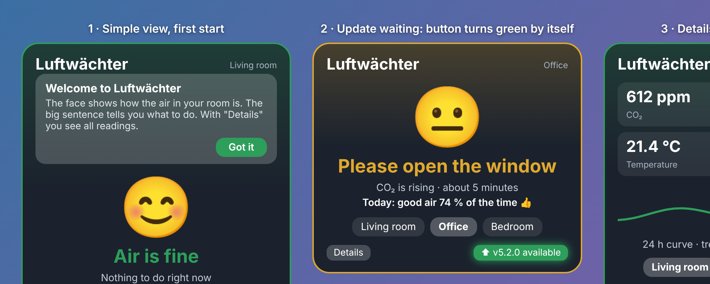

# Luftwächter (airguard-widget)

   

A small always-on-top **Windows desktop widget** that shows how good the air is in your rooms and tells you in plain words whether to ventilate. Free and open source (MIT).

- **Simple view by default**: a face, one clear sentence and the rooms, so anyone can use it; all values are one click away ("Details")
- Traffic-light ring (CO₂), the four readings (CO₂, fine dust, temperature, humidity), a 3 h / 24 h curve with trend, forecast and daily summary
- Ventilation advice ("open the window", "close it", "wait") with a ventilation timer
- All rooms at a glance, weather row with a ventilation tip
- Slide-out device panel: lights, plugs (watts), heating, blinds
- Starts with Windows and restores its look and place exactly; sizes S / M / L / compact / pill
- German and English UI (toggle in the widget), built-in help (`?`)
- Pick the sensor per reading, or let the widget average all suitable sensors in a room; it warns when a sensor stops reporting
- Hourly weather outlook, rain-aware advice, tray icon with notifications
- **Update button:** checks this repository for a newer release, shows what changed, updates itself after you confirm

Made by **Dan Stasiak** · MIT License · [github.com/DanStasiak/airguard-widget](https://github.com/DanStasiak/airguard-widget)

## How it works

**Direct mode (recommended, since v4):** the widget connects straight to your [Home Assistant](https://www.home-assistant.io). The installer finds Home Assistant in your network and asks for a long-lived access token. Every **area** that has a CO₂ or fine-dust sensor becomes a room; readings, window contacts, lights, plugs, heaters and blinds of the area are found automatically. Nothing about your home is stored in the widget. Details: [`docs/HOME-ASSISTANT.md`](docs/HOME-ASSISTANT.md).

**Server mode (optional):** instead of Home Assistant directly, the widget can talk to your own small server (for example an [n8n](https://n8n.io) workflow) that speaks a simple JSON contract.

- [`docs/HOME-ASSISTANT.md`](docs/HOME-ASSISTANT.md): how the direct mode finds rooms, sensors and devices
- [`docs/API.md`](docs/API.md): the JSON contract for server mode
- [`backend/n8n/`](backend/n8n): reference backend for server mode (with example entity IDs you replace by your own)

## Install (Windows 10/11)

1. Download `Luftwaechter-<version>.zip` from the [latest release](https://github.com/DanStasiak/airguard-widget/releases/latest) and unzip it.
2. Double-click `Installieren.bat`. A setup window (German or English) opens: press **Search network** to find Home Assistant, paste a long-lived access token (Home Assistant → your profile → Security → Long-lived access tokens), and choose whether it starts with Windows and gets a Start menu entry. It tests the connection and shows how many rooms it found. The token is stored encrypted for your Windows account only.
3. The widget appears at the top right and starts with Windows from now on. A Start menu entry "Luftwächter" lets you start it again at any time. Change the connection later: right-click → **Connect to Home Assistant…**.

`config.json` is your private file: it is kept during updates and is never uploaded.

| key | meaning |
| --- | --- |
| `haUrl` | Home Assistant address (set by the installer; the token is NOT in this file) |
| `weatherEntity` | a specific weather entity, e.g. `weather.home` (optional, default: the first one) |
| `url` | server mode only: server link that returns the room data |
| `switchUrl` | server link that accepts switch commands (optional, without it the device panel is display-only) |
| `defaultRoom` | start room key (optional) |
| `refreshSeconds` | refresh interval, 2 to 10 |
| `place` | place name shown in the weather row (optional) |
| `footer` | source note at the bottom (optional) |
| `roomShort`, `roomShortEn` | short names for the room overview, e.g. `{"living": "Living"}` |

## Choosing sensors

If a room has several sensors of one kind, the widget shows their **average** and ignores dew-point, device (chip) temperature, absolute humidity and sensors that stopped reporting. To use exactly one sensor per reading: right-click → **Choose sensors for this room…**. Give the label `airguard` to the sensors you prefer to make them win automatically. If a sensor goes silent for 20 minutes or more, the footer turns amber and names it.

## Troubleshooting

| Problem | What to do |
| --- | --- |
| "Not connected" / no rooms | Right-click → **Connect to Home Assistant…**, press **Find**, paste a new long-lived token. Rooms need an *area* with a CO₂ or fine-dust sensor. |
| A value looks wrong | Right-click → **Choose sensors for this room…** and pick the sensor you trust. |
| A device is missing | Give it the label `airguard` in Home Assistant, or right-click a device row → Hide / "show all". |
| Window closed, cannot restart | Use the Start menu entry **Luftwächter**; it also ends stuck old copies. |
| Anything else | Right-click → **Open log**, then open an [issue](https://github.com/DanStasiak/airguard-widget/issues/new/choose) (remove personal data from the log). |

## Updating

Press **⟳ Update** at the bottom right (or right-click → *Check for updates*). The widget compares its version with the latest GitHub release, shows the changes and asks whether to proceed. It then downloads the release, verifies the SHA-256 checksum and the script syntax, keeps a backup of the old version and restarts itself. Your `config.json` and state are untouched. A silent check runs every few hours; the button turns green when a new version exists.

## Uninstall

Run `Deinstallieren.bat` (removes autostart) and delete the folder `%LOCALAPPDATA%\Luftwaechter` and `%APPDATA%\Luftwaechter`.

## License and credit

MIT License, Copyright (c) 2026 Dan Stasiak. You may use, change and share it freely, also commercially, as long as the copyright notice and license text stay with it. See [LICENSE](LICENSE). Contributions welcome: [CONTRIBUTING.md](CONTRIBUTING.md).

---

# Deutsch

**Luftwächter** ist ein kleines Windows-Widget, das zeigt, wie gut die Luft in deinen Räumen ist, und in einfachen Worten sagt, ob du lüften sollst. Kostenlos und quelloffen (MIT).

**Installieren:** ZIP von der [aktuellen Version](https://github.com/DanStasiak/airguard-widget/releases/latest) laden, entpacken, `Installieren.bat` doppelklicken. Der Installer sucht Home Assistant im Netzwerk, fragt nach einem langlebigen Zugangstoken (Home Assistant → Profil → Sicherheit) und speichert ihn verschlüsselt. Räume (Bereiche mit CO₂- oder Feinstaub-Sensor), Messwerte, Fenster und Geräte werden automatisch gefunden (siehe [`docs/HOME-ASSISTANT.md`](docs/HOME-ASSISTANT.md)). Optional gibt es einen Servermodus ([`docs/API.md`](docs/API.md)).

**Sensoren wählen:** Hat ein Raum mehrere Sensoren derselben Art, zeigt das Widget den Mittelwert (Taupunkt, Geräte-Temperatur und veraltete Sensoren werden ignoriert). Rechtsklick → „Sensoren für diesen Raum wählen…“ legt je Messwert genau einen Sensor fest. Meldet ein Sensor 20 Minuten nichts, warnt die Fußzeile in Gelb.

**Aktualisieren:** Knopf **⟳ Update** unten rechts. Das Widget vergleicht seine Version mit GitHub, zeigt die Änderungen, fragt nach deiner Bestätigung, prüft den Download und tauscht sich selbst aus. Einstellungen bleiben erhalten.

**Lizenz:** MIT, © 2026 Dan Stasiak. Frei nutzbar, änderbar und weitergebbar; der Urheberhinweis muss erhalten bleiben.
