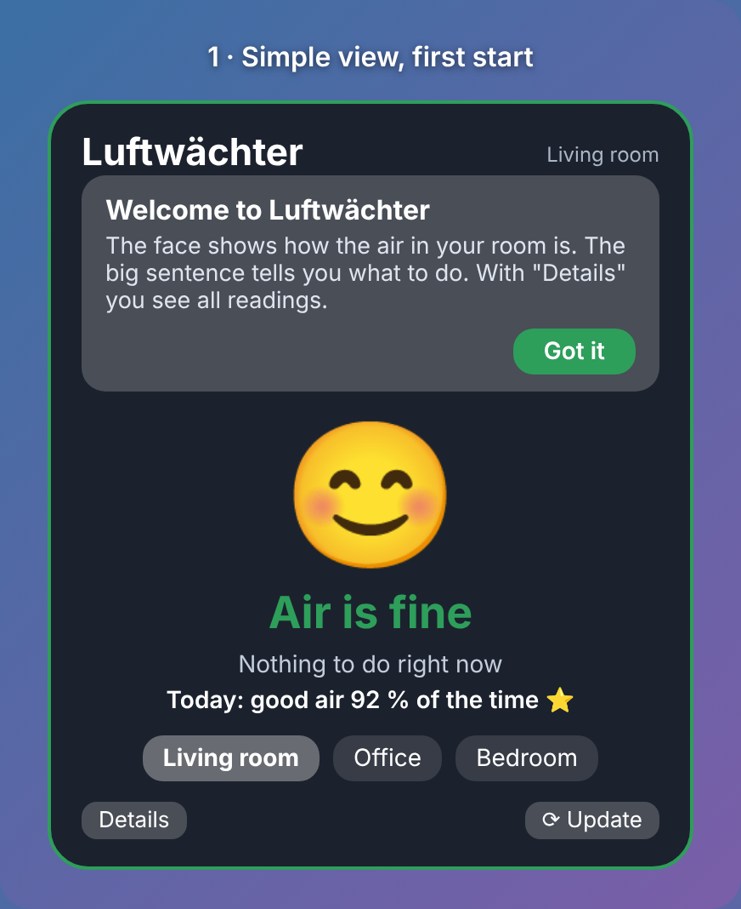
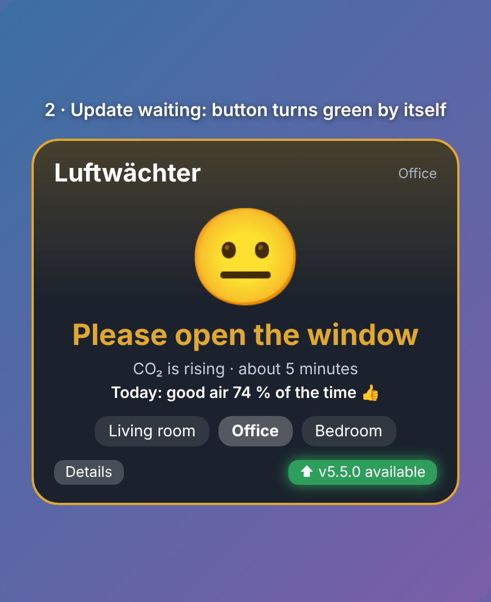
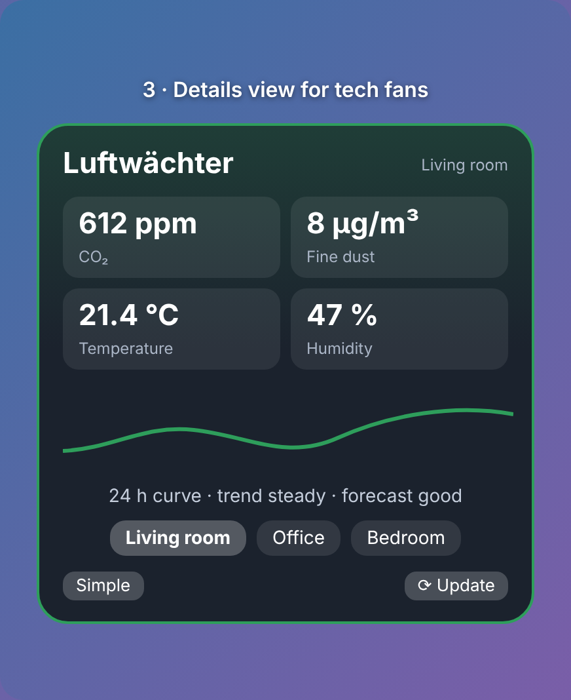
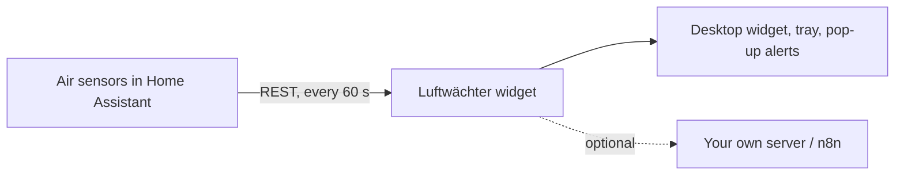

# Luftwächter (airguard-widget)

      

  

Illustrations with sample data: simple view, automatic update notice, details view.

A small always-on-top **Windows desktop widget** that shows how good the air is in your rooms and tells you in plain words whether to ventilate. Free and open source (MIT).

> **Try it in 30 seconds, no Home Assistant needed:** install the widget, right-click it and choose **Try the demo**. Three simulated rooms show how Luftwächter looks and what it tells you.

**Quick start:** (1) download the ZIP from the [latest release](https://github.com/DanStasiak/airguard-widget/releases/latest) and unzip it, (2) double-click `Installieren.bat`, (3) right-click the widget → **Try the demo**, or connect Home Assistant with **Search network**. Help: [SUPPORT.md](SUPPORT.md).

**Contents:** [Install](#install-windows-1011) · [How it works](#how-it-works) · [Choosing sensors](#choosing-sensors) · [Keyboard](#keyboard-shortcuts) · [Troubleshooting](#troubleshooting) · [Settings](docs/SETTINGS.md) · [Updating](#updating) · [FAQ](#faq) · [Privacy](#privacy) · [Uninstall](#uninstall) · [Deutsch](#deutsch)

**Which one do I need?**

| | Luftwächter widget (this repo) | [luftwaechter-ha](https://github.com/DanStasiak/luftwaechter-ha) |
| --- | --- | --- |
| What it is | Small always-on-top window for a Windows PC | Home Assistant integration with a sidebar panel |
| Best for | A glance at the desk or in the kitchen, pop-ups, tray icon | Phone, tablet, wall display, automations |
| Needs | Windows 10/11 and (optionally) Home Assistant | Home Assistant 2025.10 or newer |
| Use both? | Yes: they read the same sensors and agree on the ratings | |

- **Simple view by default**: a face, one clear sentence and the rooms, so anyone can use it; all values are one click away ("Details")
- Traffic-light ring (CO₂), the four readings (CO₂, fine dust, temperature, humidity), a 3 h / 24 h curve with trend, forecast and daily summary
- Ventilation advice ("open the window", "close it", "wait") with a ventilation timer
- All rooms at a glance, weather row with a ventilation tip
- Slide-out device panel: lights, plugs (watts), heating, blinds
- Starts with Windows and restores its look and place exactly; sizes S / M / L / compact / pill, plus an extra-large size; right-click → *Make bigger / smaller* (or Ctrl + mouse wheel) works in the simple view too
- German and English UI (toggle in the widget), built-in help (`?`)
- Pick the sensor per reading, or let the widget average all suitable sensors in a room; it warns when a sensor stops reporting
- Hourly weather outlook, rain-aware advice, tray icon with notifications
- **Update button:** checks this repository by itself (every 60 minutes by default) and turns green with the new version number when one is waiting; one click shows what changed and updates after you confirm
- **Welcome card** on first start explains the simple view in three sentences; after each update a "What's new" card shows the changes once
- **Demo mode:** right-click → *Try the demo* shows simulated rooms, so you can try the widget without Home Assistant
- **Day and night design:** solid, crisp colours; the background gets deeper at night, switchable by right-click → *Theme* (automatic, day, night)
- **Quiet time:** right-click → *Quiet for 1 hour* or *until tomorrow morning* mutes pop-up, tray notice and chime for a call or a nap
- Double-click the title to switch between the simple and the details view
- **Export:** right-click → *Save history as CSV* saves the last 7 days of all rooms to a file you can open in Excel
- **Keyboard:** ← / → rooms, D simple/details, + / − size, F5 refresh, Ctrl+C copy, Q quiet, T theme, F1 help, Esc close; the widget snaps to screen edges
- **Built-in explanations:** the help explains CO₂, fine dust, temperature and humidity (what they are, the limits, common causes of poor readings, what helps); sections fold, show the current reading, and right-clicking a value tile jumps to its explanation
- **Look and feel:** highlighted size picker, soft glow on hover for everything clickable, smooth fade when switching rooms, right-click menu sorted into groups with a *More* submenu, tooltips on the header controls
- **House at a glance:** window title shows e.g. "2 of 5 rooms poor"; hover a room button for its CO₂ and rating; keys 1–9 pick a room; *Copy all rooms* (Ctrl+Shift+C); screen-reader names
- **Chart hover:** move the mouse over the curve to read the exact time and value; daily min/max show their times; tooltips on the tiles explain the ranges; tray tooltip names the worst room; slower polling while minimized
- **Home Assistant shortcuts:** right-click → *More* → *Open Home Assistant* or *Open the Luftwächter panel* (full-size view from the [integration](https://github.com/DanStasiak/luftwaechter-ha)), and *Copy diagnostics* for bug reports
- **Copy readings** (right-click) for pasting into a message; tray menu with *Refresh now*, *Quiet for 1 hour* and *Quiet until tomorrow morning* (quiet time survives a restart); mouse wheel over the room buttons switches rooms
- **Daily air score** in the simple view: "Today: good air 92 % of the time", counted from today's readings, plus a 7-day score

Made by **Dan Stasiak** · MIT License · [github.com/DanStasiak/airguard-widget](https://github.com/DanStasiak/airguard-widget)

## How it works

**Direct mode (recommended, since v4):** the widget connects straight to your [Home Assistant](https://www.home-assistant.io). The installer finds Home Assistant in your network and asks for a long-lived access token. Every **area** that has a CO₂ or fine-dust sensor becomes a room; readings, window contacts, lights, plugs, heaters and blinds of the area are found automatically. Nothing about your home is stored in the widget. Details: [`docs/HOME-ASSISTANT.md`](docs/HOME-ASSISTANT.md).

**Server mode (optional):** instead of Home Assistant directly, the widget can talk to your own small server (for example an [n8n](https://n8n.io) workflow) that speaks a simple JSON contract.

- [`docs/HOME-ASSISTANT.md`](docs/HOME-ASSISTANT.md): how the direct mode finds rooms, sensors and devices
- [`docs/API.md`](docs/API.md): the JSON contract for server mode
- [`backend/n8n/`](backend/n8n): reference backend for server mode (with example entity IDs you replace by your own)

## Install (Windows 10/11)

1. Download `Luftwaechter-<version>.zip` from the [latest release](https://github.com/DanStasiak/airguard-widget/releases/latest) and unzip it.
2. Double-click `Installieren.bat`. A setup window (German or English) opens: press **Search network** to find Home Assistant, paste a long-lived access token (Home Assistant → your profile → Security → Long-lived access tokens), and choose whether it starts with Windows and gets a Start menu entry. It tests the connection and shows how many rooms it found. The token is stored encrypted for your Windows account only.
3. The widget appears at the top right and starts with Windows from now on. A Start menu entry "Luftwächter" lets you start it again at any time. Change the connection later: right-click → **Connect to Home Assistant…**.

`config.json` is your private file: it is kept during updates and is never uploaded.

| key | meaning |
| --- | --- |
| `haUrl` | Home Assistant address (set by the installer; the token is NOT in this file) |
| `weatherEntity` | a specific weather entity, e.g. `weather.home` (optional, default: the first one) |
| `url` | server mode only: server link that returns the room data |
| `switchUrl` | server link that accepts switch commands (optional, without it the device panel is display-only) |
| `defaultRoom` | start room key (optional) |
| `refreshSeconds` | refresh interval, 2 to 10 |
| `updateCheckMinutes` | how often the widget looks for a new release, 15 to 1440 (default 60) |
| `place` | place name shown in the weather row (optional) |
| `footer` | source note at the bottom (optional) |
| `roomShort`, `roomShortEn` | short names for the room overview, e.g. `{"living": "Living"}` |

## Choosing sensors

If a room has several sensors of one kind, the widget shows their **average** and ignores dew-point, device (chip) temperature, absolute humidity and sensors that stopped reporting. To use exactly one sensor per reading: right-click → **Choose sensors for this room…**. Give the label `airguard` to the sensors you prefer to make them win automatically. If a sensor goes silent for 20 minutes or more, the footer turns amber and names it.

## Keyboard shortcuts

Click the widget once, then:

| Key | Action | Key | Action |
| --- | --- | --- | --- |
| ← / → | other room | D | simple view / details |
| 1–9 | pick a room | Home / End | first / last room |
| + / − | bigger / smaller | F5 | refresh now |
| Ctrl+C | copy readings | Ctrl+Shift+C | copy all rooms |
| Q | quiet time on/off | T | change theme |
| A | last alerts | | |
| L | language | U | check for updates |
| O | transparency (100 / 85 / 70 %) | P | always on top |
| W | weather row open / closed | E | save history as CSV |
| G | open Home Assistant | Ctrl+Shift+S | save a picture |
| Ctrl+Shift+D | copy diagnostics | F1 / Esc | help / close |

## Alerts and quiet hours

When the advice changes to *open* or *close* the window, Luftwächter can play a soft sound, show a balloon next to the clock and a pop-up. By default it stays silent from 22:00 to 07:00. Right-click → **Quiet hours** steps through 22–7, 23–6, 21–8, 20–9 and off. Key **Q** or *Quiet for an hour* mutes everything for a while. Key **A** (or Advanced → *Last alerts…*) lists the last 15 changes, even those that arrived while quiet. *Send a test alert* (Advanced) shows what an alert looks like. Details: [`docs/ALERTS.md`](docs/ALERTS.md).

## Window options

Right-click the widget: **Lock position** (no accidental dragging), **Transparency** (also key **O**), **Show in the taskbar**. **Snap to screen edges** and **Start hidden in the tray** can be switched off or on. The tray menu also has *Transparency* and *Lock position*. **Fully opaque on hover** makes a see-through widget solid while the mouse is over it. Press **P** to keep it on top. Under **Advanced** you find **Start with Windows**, which adds or removes the autostart shortcut for you, and **Back up settings…** / **Restore settings…**, which save and load your look (theme, language, transparency, lock and so on) as a small file in *Documents*. That makes moving to a new PC a two-click job. Your Home Assistant token is never part of the backup.

## Where settings are stored

| What | Where |
| --- | --- |
| Position, size, theme, language, window options | `%APPDATA%\Luftwaechter\state.json` |
| Your connection (address, refresh time) | `config.json` next to the app |
| Home Assistant token | `%APPDATA%\Luftwaechter\ha-token.bin` (encrypted for your Windows account) |
| Log for troubleshooting | `%APPDATA%\Luftwaechter\protokoll.txt` |

Uninstalling removes the app; delete the `%APPDATA%\Luftwaechter` folder to remove everything.

## Command line

| Command | What it does |
| --- | --- |
| `powershell -ExecutionPolicy Bypass -File Luftwaechter.ps1 -Install` | install for the current user (what `Installieren.bat` runs) |
| `... -Uninstall` | remove the program and shortcuts (what `Deinstallieren.bat` runs) |
| `... -SmokeTest` | run the built-in self-tests without showing the window (used by the CI) |

## Verify your download

Each release has a `SHA256SUMS.txt`. In PowerShell: `Get-FileHash .\Luftwaechter-<version>.zip -Algorithm SHA256` must print the same value as the line for that file.

## System requirements and contents

- Windows 10 or 11 with the built-in Windows PowerShell 5.1 (nothing to install). Home Assistant reachable on your network (optional: the demo works without it).
- The download contains `Luftwaechter.ps1` (the app), `Installieren.bat` / `Deinstallieren.bat` (install and remove), `Start.vbs` (start without a console window), `config.example.json`, the licence, this README and the changelog.

## Troubleshooting

| Problem | What to do |
| --- | --- |
| "Not connected" / no rooms | Right-click → **Connect to Home Assistant…**, press **Find**, paste a new long-lived token. Rooms need an *area* with a CO₂ or fine-dust sensor. |
| A value looks wrong | Right-click → **Choose sensors for this room…** and pick the sensor you trust. |
| A device is missing | Give it the label `airguard` in Home Assistant, or right-click a device row → Hide / "show all". |
| Window closed, cannot restart | Use the Start menu entry **Luftwächter**; it also ends stuck old copies. |
| The widget is not on screen | Look for the icon next to the clock and click it. Still nothing: right-click the tray icon → *Open*, then right-click the widget → *Reset position*. |
| The widget is too faint to read | Press **O** until it is solid again (or turn on *Fully opaque on hover*). |
| I get no alerts | Check quiet hours (right-click → *Quiet hours*), *Quiet for an hour* (title shows 🔕) and the sound / pop-up / tray options. *Send a test alert* (Advanced) proves that Windows plays sounds and shows balloons. |
| My settings were lost after a crash | A damaged settings file is kept as `state.json.bad` in the data folder and the widget starts fresh. Restore your look with *Restore settings…*. |
| Something is wrong and I do not know what | Right-click → Advanced → *Report a problem…* copies the diagnostics and opens the GitHub form; paste them there. |
| Windows says "unknown publisher" (SmartScreen) | The widget is not code-signed. Choose **More info → Run anyway**, or check the download first: `Get-FileHash` must match `SHA256SUMS.txt` on the release page. |
| Installer shows a red error about scripts | Use `Installieren.bat` (it starts PowerShell with the right settings); do not run the `.ps1` by double-click. |
| Bug report needs details | Right-click → **More → Copy diagnostics (for support)** and paste it into the issue (or use right-click → *Report a problem*). It never contains your token or Home Assistant address. |
| Anything else | Right-click → **Open log**, then open an [issue](https://github.com/DanStasiak/airguard-widget/issues/new/choose) (remove personal data from the log). |

## FAQ

**How do I move my look to a new PC?** Right-click → Advanced → *Back up settings…*, copy the file from *Documents* to the new PC and use *Restore settings…* there. Home Assistant needs its own token on each PC.

**How do I start it hidden?** Right-click → *Start hidden in the tray*. A click on the tray icon shows it.

**Can I change when it is quiet?** Yes: right-click → *Quiet hours* picks 22–7, 23–6, 21–8, 20–9 or off. Alerts are still listed under key **A**.

**Where are the details of every setting?** In [`docs/SETTINGS.md`](docs/SETTINGS.md).

**Can I use it on a second PC?** Yes. Install it on each PC (the ZIP is the same). Each copy has its own token and settings.

**Does it work without internet?** The widget only needs your local network and Home Assistant. Without internet it simply cannot check for updates.

**What does the widget send, and where?** It talks to your Home Assistant (your address, your token) and asks GitHub once an hour for the newest version number. Nothing else leaves your PC. There is no telemetry and no account. See [Privacy](#privacy).

**Can I show it to someone?** Right-click → *Save a picture of the widget* or *Copy a picture of the widget*.

**How do I remove it?** Run `Deinstallieren.bat` (see [Uninstall](#uninstall)).

## Privacy

- Your Home Assistant token is stored encrypted for your Windows account (`ha-token.bin`); it is never written to `config.json`, the log or the diagnostics.
- The update check calls the public GitHub API for this repository. The download is verified against `SHA256SUMS.txt` before it replaces the program.
- Diagnostics and pictures are created only when you ask for them and are never sent anywhere by the widget.

## Updating

Press **⟳ Update** at the bottom right (or right-click → *Check for updates*). The widget compares its version with the latest GitHub release, shows the changes and asks whether to proceed. It then downloads the release, verifies the SHA-256 checksum and the script syntax, keeps a backup of the old version and restarts itself. Your `config.json` and state are untouched. The widget also checks silently on its own (default every 60 minutes, `updateCheckMinutes` in `config.json`): when a new version exists, the button turns green, pulses gently and shows the version number, and a tray notice appears once. Hover the button to see when it last checked.

## Support the project

Luftwächter is free and stays free. If it brightens your home and you would like to say thanks, you can [buy me a coffee](https://buymeacoffee.com/dstasiak) (the *Sponsor* button on this page leads there too; in the widget: right-click → *Buy me a coffee*). Entirely optional: the widget never asks, never shows pop-ups about it and sends nothing anywhere.

## Built for Home Assistant ♥

Luftwächter exists because of [Home Assistant](https://www.home-assistant.io), the free, open-source, local-first smart-home platform. If you like it as much as we do, please support the project: [donate to the Open Home Foundation](https://www.openhomefoundation.org) or subscribe to [Home Assistant Cloud](https://www.nabucasa.com). The widget has a *Support Home Assistant* entry in its right-click menu.

> Luftwächter is an independent community project. It is not affiliated with, endorsed by or sponsored by Home Assistant, Nabu Casa or the Open Home Foundation. "Home Assistant" is a trademark of its respective owners; this project uses the name only to say what it works with and does not use their logo.

## Uninstall

Run `Deinstallieren.bat` (removes autostart) and delete the folder `%LOCALAPPDATA%\Luftwaechter` and `%APPDATA%\Luftwaechter`.

## License and credit

MIT License, Copyright (c) 2026 Dan Stasiak. You may use, change and share it freely, also commercially, as long as the copyright notice and license text stay with it. See [LICENSE](LICENSE). Contributions welcome: [CONTRIBUTING.md](CONTRIBUTING.md) · [Code of Conduct](CODE_OF_CONDUCT.md) · [Security](SECURITY.md).

---

# Deutsch

**Luftwächter** ist ein kleines Windows-Widget, das zeigt, wie gut die Luft in deinen Räumen ist, und in einfachen Worten sagt, ob du lüften sollst. Kostenlos und quelloffen (MIT).

**Schnellstart:** ZIP laden, entpacken, `Installieren.bat` doppelklicken, dann Rechtsklick → „Demo ausprobieren“ oder Home Assistant verbinden. Hilfe: [SUPPORT.md](SUPPORT.md).

**Installieren:** ZIP von der [aktuellen Version](https://github.com/DanStasiak/airguard-widget/releases/latest) laden, entpacken, `Installieren.bat` doppelklicken. Der Installer sucht Home Assistant im Netzwerk, fragt nach einem langlebigen Zugangstoken (Home Assistant → Profil → Sicherheit) und speichert ihn verschlüsselt. Räume (Bereiche mit CO₂- oder Feinstaub-Sensor), Messwerte, Fenster und Geräte werden automatisch gefunden (siehe [`docs/HOME-ASSISTANT.md`](docs/HOME-ASSISTANT.md)). Optional gibt es einen Servermodus ([`docs/API.md`](docs/API.md)).

**Sensoren wählen:** Hat ein Raum mehrere Sensoren derselben Art, zeigt das Widget den Mittelwert (Taupunkt, Geräte-Temperatur und veraltete Sensoren werden ignoriert). Rechtsklick → „Sensoren für diesen Raum wählen…“ legt je Messwert genau einen Sensor fest. Meldet ein Sensor 20 Minuten nichts, warnt die Fußzeile in Gelb.

**Aktualisieren:** Knopf **⟳ Update** unten rechts. Das Widget vergleicht seine Version mit GitHub, zeigt die Änderungen, fragt nach deiner Bestätigung, prüft den Download und tauscht sich selbst aus. Einstellungen bleiben erhalten. Das Widget prüft auch von selbst (standardmäßig alle 60 Minuten, `updateCheckMinutes` in `config.json`): Gibt es eine neue Version, wird der Knopf grün und zeigt die Versionsnummer; zusätzlich erscheint einmal eine Hinweis-Meldung im Infobereich. Luftwächter gibt es dank [Home Assistant](https://www.home-assistant.io): Wenn es dir gefällt, unterstütze das Projekt (Open Home Foundation, Home Assistant Cloud). Luftwächter ist unabhängig und steht in keiner Verbindung zu Home Assistant oder der Open Home Foundation. **In 30 Sekunden ausprobieren, ohne Home Assistant:** Widget installieren, Rechtsklick → *Demo ausprobieren* zeigt drei simulierte Räume. Rechtsklick → *Ruhe für 1 Stunde* schaltet Pop-up, Hinweis und Ton für eine Stunde stumm. Rechtsklick → *Verlauf als CSV speichern* legt die letzten 7 Tage als Excel-Datei in „Dokumente“ ab. Tastatur: ← / → Raum, D Ansicht, + / − Größe, F5 aktualisieren, Esc schließen. Rechtsklick → *Werte kopieren* legt die aktuellen Werte in die Zwischenablage; das Mausrad über den Raum-Knöpfen wechselt den Raum. Beim ersten Start erklärt eine kurze Willkommenskarte die einfache Ansicht. Rechtsklick → *Größer anzeigen* (oder Strg + Mausrad) vergrößert das Widget bis „extra groß“, auch in der einfachen Ansicht. In der einfachen Ansicht zeigt eine Tagesnote, wie oft die Luft heute gut war (CO₂ unter 1000 ppm).

**Datenschutz:** Das Widget spricht nur mit deinem Home Assistant und fragt bei GitHub nach der neuesten Versionsnummer. Es gibt keine Telemetrie und kein Konto. Der Token liegt verschlüsselt für dein Windows-Konto (`ha-token.bin`).

**FAQ:** Zweiter PC: einfach dort ebenfalls installieren. Ohne Internet läuft das Widget im Heimnetz, nur die Update-Prüfung entfällt. Bild zum Zeigen: Rechtsklick → „Bild vom Widget speichern“.

**Lizenz:** MIT, © 2026 Dan Stasiak. Frei nutzbar, änderbar und weitergebbar; der Urheberhinweis muss erhalten bleiben.
